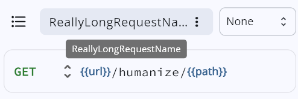

# Request Editor

The Request Editor is the main workspace in API Dash where you create, configure, and send API requests.

## Creating a Request

1. Click the **"+"** button in the collection pane to add a new request.
2. The Request Editor opens with a blank request ready for configuration.

## Configuring the Request

### HTTP Method & URL

- Select the HTTP method from the dropdown: **GET**, **POST**, **PUT**, **PATCH**, **DELETE**, **HEAD**, or **OPTIONS**.
- Enter the full API endpoint URL in the URL bar (e.g., `https://api.apidash.dev/users`).
- If you omit the scheme, API Dash adds `https://` by default.

### Request Type

API Dash supports three request types, selectable from the request type switcher:

- **HTTP:** Standard REST API requests.
- **GraphQL:** Send GraphQL queries and mutations with dedicated query and variables editors.
- **AI:** Send prompts to AI model providers.

### Query Parameters

Switch to the **Params** tab to add URL query parameters:

- Click **"Add Parameter"** to add a new row.
- Enter the **key** and **value** for each parameter.
- Parameters are automatically appended to the URL as `?key=value&key2=value2`.
- Use the checkbox next to each parameter to enable or disable it without deleting.

### Headers

Switch to the **Headers** tab to add custom HTTP headers:

- Click **"Add Header"** to add a new row.
- Enter the **header name** and **value**.
- Common headers like `Content-Type` and `Authorization` are auto-suggested.
- Use the checkbox to toggle individual headers on or off.

### Request Body

Switch to the **Body** tab to set the request body (available for POST, PUT, PATCH, DELETE):

- Select the body content type:
  - **JSON:** Enter JSON data with syntax highlighting and validation.
  - **Text:** Plain text body content.
  - **Form URL-Encoded:** Key-value pairs sent as `application/x-www-form-urlencoded`.
  - **Multipart Form Data:** Key-value pairs with file upload support sent as `multipart/form-data`.
- The `Content-Type` header is set automatically based on your selection.

### Authentication

Switch to the **Authentication** tab to configure credentials. API Dash supports multiple authentication methods including API Key, Bearer Token, Basic Auth, Digest, JWT, OAuth 1.0, and OAuth 2.0. See the [Authentication Guide](./authentication.md) for detailed instructions.

### Scripts

- **Pre-Request Script:** JavaScript code that runs before the request is sent. Use it to dynamically set headers, parameters, or the request body.
- **Post-Response Script:** JavaScript code that runs after the response is received. Use it to extract data, run tests, or update environment variables.

See the [Scripting Guide](./scripting_user_guide.md) for the full `ad` object API reference.

## Sending the Request

Click the **Send** button (or press the keyboard shortcut) to execute the request. The response appears in the response pane below or beside the editor.

## Viewing the Response

The response pane displays:

- **Status Code:** The HTTP status code (e.g., 200 OK, 404 Not Found).
- **Response Time:** How long the request took in milliseconds.
- **Response Size:** The size of the response body.
- **Response Headers:** All headers returned by the server.
- **Response Body:** The content, viewable in multiple modes:
  - **Preview:** Rendered view (formatted JSON, images, PDFs, audio, video, etc.).
  - **Code:** Syntax-highlighted raw response.
  - **Raw:** Plain text output.

API Dash supports previewing 50+ MIME types including JSON, XML, HTML, images, PDFs, audio, and video.

## Exporting API Documentation & Reproduction Sessions

Once an API response has been received, you can export the full request-response transaction directly from the response header:

1. Click the **"Export API Documentation"** icon button (`Icons.description_outlined`) in the Response Pane Header.
2. Select between:
   - **Markdown (.md)**: Generates technical API documentation with method, endpoint, headers table, query parameters, body, status code, latency, and response payload.
   - **cURL Session**: Generates an executable multi-line bash `curl` command with flags (`-X`, `-H`, `--data`) and a commented response summary (`# Response: 200 OK (45 ms)`).
3. Click **"Copy to Clipboard"** for quick sharing or **"Save to File"** to save to local disk (`<request_name>_api_doc.md`).

For detailed examples and output templates, see the [Markdown Documentation Export Guide](./export_markdown_doc_guide.md).

## Request Name Tooltip

Hovering on Desktop or long-pressing on Mobile displays a tooltip with the full request name for requests with long names.

## Tips

- Use `{{variable_name}}` syntax in URLs, parameters, and header values to insert [Environment Variables](./env_user_guide.md).
- Disable [SSL verification](./disable_ssl.md) in Settings if you need to test against servers with self-signed certificates.
- Use the [Code Generation](./code_generation_guide.md) panel to export your configured request as runnable code in 30+ languages.
